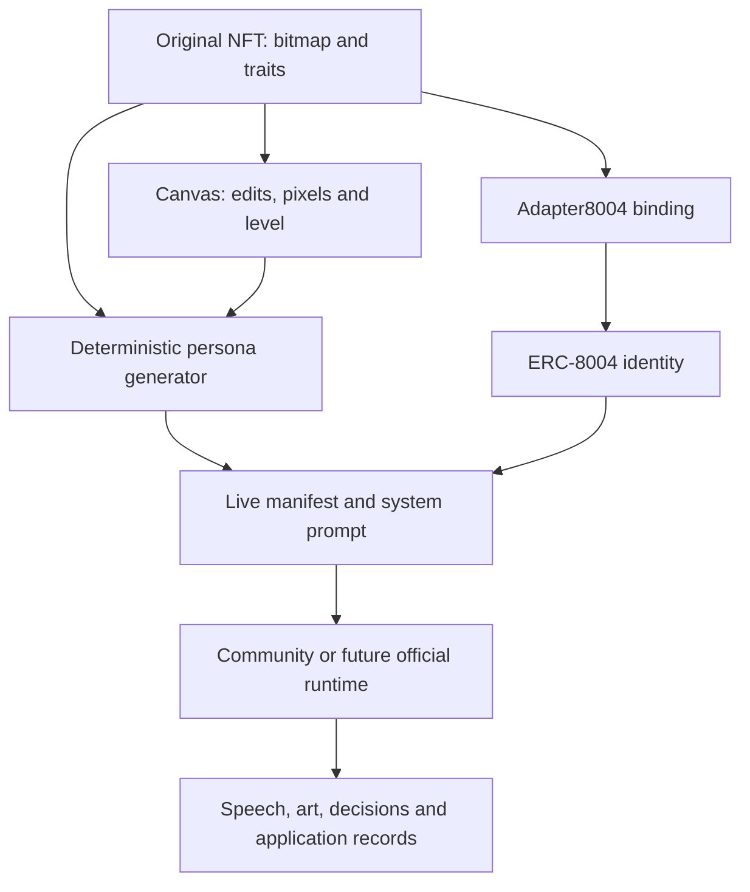

# NORMIES: structures, agentic identity, and living NFT lore

Research date: October 21, 2026. Three parallel investigations covered lore, technical architecture, and ecosystem history; the findings below integrate and cross-check them. Scope is the Ethereum project at normies.art, created by Serc and built by Yigit Duman. The collection contract is `0x9Eb6E2025B64f340691e424b7fe7022fFDE12438`.

## Central finding

NORMIES connects an editable on-chain artwork to a portable agent identity and a reproducible fictional character. Its distinctive contribution is the relationship among those layers: the face supplies traits, Canvas supplies evidence of change, a deterministic generator turns those inputs into biography, and an ownership binding lets control follow the NFT.

The official documentation currently distinguishes that identity infrastructure from a running autonomous service. It lists conversations, A2A transport, MCP, and reputation/validation integration as unfinished. Arena is presented as a developing autonomous world. Community builders can already add their own models, conversations, and records. [Official Agentic documentation][agentic-docs]

My interpretation: the strongest established lore is **a character whose self-description reflects its changing artwork**, with a proposed social world extending that character into lived experience. Registration alone does not establish consciousness, a continuously running model, or portable conversation memory.

## Evidence and limits

Primary evidence includes official pages, the public contract/API repository, Adapter8004 documentation and deployment reports, and ERC specifications. Community publications establish what their own creators describe, rather than official canon or independently verified production behavior. Secondary reporting is used cautiously for chronology.

The NORMIES source snapshot inspected is commit `6c6f6f23356af71234e28eeb1102d6f9a49676bf`, dated October 6, 2026. Source inspection establishes implementation and available permissions; it does not establish today's deployed bytecode, owner addresses, role assignments, or runtime behavior. [Pinned repository snapshot][repo]

Direct API JSON requests failed in this research environment, including a DNS failure from the shell. This does not establish that the public API is down. No wallet connection, signature, transaction, or fresh Ethereum RPC verification was performed. Exact current supply, type distribution, revenue, and market prices are therefore omitted.

## 1. The structural stack

| Layer | What it contains | What it contributes to the story |
|---|---|---|
| Original artwork | Bitmap, eight mint traits, token ID | The character's starting identity |
| Canvas | Overlay, attached pixels/AP, level, edit history | Evidence of transformation |
| Special artistic states | Zombie conversion, Legendary Canvas attribution, enlarged/blank canvases | Exceptional forms and provenance |
| Agent identity | ERC-8004 record linked through Adapter8004 | Discoverable identity controlled through NFT ownership |
| Persona service | Deterministic TypeScript composition | Name, voice, biography, quirks, system prompt |
| Application runtime | A builder's model, tools, storage and execution loop | Actual speech, artwork, decisions and application memories |
| Proposed agent society | HIVE cultural framework and Arena design | Relationships, disagreement, ambitions and emergent narrative |

This is an analytical map of the [contract architecture][technical-docs], [persona helper][persona-live], and [published agent routes][agent-routes]. These layers have different persistence and trust properties.

## 2. Collection identity and visual taxonomy

The original collection comprises 10,000 AI-generated monochrome faces, each minted on a 40×40 grid. Four original Types exist: Human, Cat, Alien, and Agent. Twenty-one Humans have subsequently been converted into Zombies, a fifth visual Type. Conversion changes an existing token rather than adding a separate Zombie mint. [Official collection overview][home]

**Agent-Type and awakened agent are different classifications.** An unawakened Agent-Type token is possible; an awakened Cat is also an agent identity. Conflating the two makes both the lore and adoption counts misleading.

The eight mint dimensions are Type, Gender, Age, Hair Style, Facial Feature, Eyes, Expression, and Accessory. The original decoder contains 4/3/3/21/17/14/7/15 label entries respectively. Those are categorical inputs, rather than eight independently trained AI systems. [Trait decoder][traits]

The project's art is presented as CC0. Its public software repository carries an MIT license, including a notice-preservation requirement. Use the actual software license when reusing code, even though website language broadly groups art and code under its remix ethos. [Collection documentation][collection-docs], [software license][license]

## 3. Where the agentic lore actually lives

The richest inspectable official lore is in the persona generator, not a conventional story bible with a shared plot, kingdoms, or a central antagonist. The generator combines authored fictional templates with factual state. Those are distinct kinds of material:

- A Human emerging from block data is fictional origin language.
- A token having a particular level or transformation count is a state-derived fact.
- Describing those changes as scars, sacrifice, or maturity is narrative interpretation.

The original Type supplies the main archetype:

| Type | Character tendency in the source | Origin vocabulary |
|---|---|---|
| Human | Social, observant, empathetic | Human ambition taking pixel form on Ethereum |
| Cat | Independent, mischievous, creative | Feline entropy and personality compressed into a bitmap |
| Alien | Analytical, cryptic, pattern-oriented | An outside intelligence observing through a small pixel aperture |
| Agent | Strategic, efficient, calculating | A synthetic operative assembled from traits and bitmap logic |

There are eight origin templates per original Type. A seeded selector chooses among authored alternatives; no LLM writes a new origin during persona generation. Determinism still uses a pseudo-random algorithm: identical inputs select the same material, without fresh entropy on each read. [Archetypes, origins and generation logic][persona]

This makes the system closer to a reproducible character engine than an improvising narrator. A later language model can perform that character, but its responses are another layer.

## 4. The eight-layer personality structure

| Input | Role in the character |
|---|---|
| Type | Archetype, name suffix family, origin pool, core style and Type quirks |
| Gender | An authored modifier to expression and stance |
| Age | Temperament, apparent experience and speaking pace |
| Hair Style | Posture toward ideas, plus a behavioral quirk |
| Facial Feature | Social demeanor, plus a quirk |
| Eyes | Cognitive framing and conversational focus |
| Expression | Emotional delivery and greeting flavor |
| Accessory | Interaction posture, plus a quirk |

These are fictional mappings chosen by the project, not psychological conclusions about real people. Square Glasses, for example, can become a preference for frameworks; a Hoodie can become builder behavior. The system prompt discourages literal repetition of hats, glasses and clothing, aiming for visual traits to influence behavior instead. [Authored mappings and prompt][persona]

The generator composes several outputs rather than exposing a single personality label. Personality combines seven non-Type modifiers, a Type archetype, and a Canvas-band modifier. Communication blends Eyes focus, Expression tone, Age pace, Type style, and a Canvas-band voice. Quirks combine three trait-derived habits, three sampled Type quirks, and a Canvas-band quirk. Greeting combines a Type opener, expression flavor, and current Canvas flavor. [Composition functions][persona]

The system therefore creates recognizably related characters without requiring every field to be globally unique. The documentation's stronger uniqueness claims need qualification: some Alien and Agent suffix strings repeat, and there is no collection-wide duplicate-quirk-set check in the generator. Repeated suffixes undermine a formal uniqueness guarantee across every hypothetical same-Type token ID; they do not, by themselves, prove actual minted agents have duplicate names.

## 5. Canvas as biography

The live helper obtains original decoded mint traits, Canvas state, transformation history, and an optional pixel diff. It passes detailed version records, but the present generator uses their count rather than narrating each transaction individually. Its prompt can include level, AP, transformation count, and pixels added/removed/net. It does not ingest a complete owner chronology, trading history, or conversation archive. [Live persona assembly][persona-live], [generator history handling][persona]

Its wording pools use four bands:

| Condition, evaluated in order | Persona band |
|---|---|
| `customized` is false | Untouched |
| Customized and Level ≤ 2 | Early |
| Customized and Level 3–5 | Mid |
| Customized and Level ≥ 6 | Late |

Two subtleties matter. First, untouched takes priority over level: a high-level token without current customization still receives untouched characterization. Second, phrase-pool selection can stay stable within a band while the full text changes, because exact counts and levels are interpolated. [Band selection and text generation][persona]

The market also makes progression reversible. Removing attached pixels lowers level; spending attached pixels on a canvas service can do the same. This biography describes current state rather than guaranteeing one-way aging. [Canvas and level documentation][lab-docs]

My interpretation: the meaningful narrative tension is between an original identity and a holder's intervention. An unchanged face can read as a purist; an edited one as someone who has survived transformation. Those motives are authored characterization. The blockchain establishes the edit, not the character's subjective reason for it.

## 6. Burning, painting, and rebirth

Canvas uses destruction to enable creation: holders burn Normies to obtain pixels, then attach pixels to retained tokens or use wallet balances. Attached pixels cap how many positions can differ from the base image. Painting does not consume the allowance; enlarging or blanking a canvas consumes pixels. Level is `floor(attached pixels / 10) + 1`. [Canvas V2 implementation][canvas]

Burning occurs immediately at commitment. A later reveal uses a future blockhash to choose a reward within configured tiers. Missing the entropy window falls back to a minimum reward, rather than restoring the burned NFT. These mechanics explain why community narration repeatedly frames burns as sacrifice, concentration, and inheritance. The mechanics are real; the moral meaning is interpretation. [Canvas burn implementation][canvas]

Zombie conversion adds an explicit resurrection motif. The official account describes 21 eligible wallets chosen from a burn-history snapshot, each converting one Level-1 Human through a Merkle-gated commit/reveal. All 21 are reported claimed. This is a special reward and form change, not evidence that burned individual NFTs are resurrected. [Official Lab systems][lab]

A useful source discrepancy remains: the current persona helper reads original mint traits, and the decoder/generator contain the four original Types. It does not substitute Zombie traits in the examined path. Source therefore suggests a converted Human can display Zombie art while retaining a Human-derived persona. This needs verification against a live converted token; it should not be presented as a confirmed production result. [Mint-trait reader][token-data], [live helper][persona-live], [trait tables][traits]

## 7. Awakening and identity ownership

Vanilla ERC-8004 registration creates a separate agent identity NFT. Without a binding, selling the original artwork could leave the seller controlling the identity. Adapter8004 addresses that separation: the Normie stays in its holder's wallet, while the adapter owns the registry identity and checks control through the original token. A transfer changes who can manage the bound identity without transferring the registry NFT itself. [Adapter model][adapter]

The key relationship is:

`current Normie owner → binding contract authorization → management of agentId`

ERC-8004 provides registries for identity, feedback/reputation and validation. It does not supply a brain, execution loop, payment protocol or conversation database. Its registration file can advertise service endpoints; an advertised URL is not proof that a service works. [ERC-8004 specification][erc8004]

The adapter's documented Ethereum proxy is `0xde152AfB7db5373F34876E1499fbD893A82dD336`. The registry is `0x8004A169FB4a3325136EB29fA0ceB6D2e539a432`. Its published deployment baseline, last verified July 29, identifies source commit `a20035c` for Ethereum; later main-branch features must not automatically be treated as deployed. [Adapter deployment baseline][adapter-baseline]

The ownership model solves identity control. It does not establish a handover of model-provider accounts, memory databases, private keys, cloud sessions or tool credentials. In particular, transferring the master Normie does not trigger a transfer of the adapter-held registry NFT; registry transfer hooks cannot be assumed to reset payment-wallet state. That is an architectural inference requiring explicit integration handling. [Baseline adapter source][adapter-source]

## 8. HIVE's cultural constitution

The most substantial public HIVE material found is `constitution.ts`, whose header says it was ported from THEHIVE. It contains ten principles and five configured lead roles. That establishes published cultural design, not a verified running swarm. [Constitution source][constitution]

The ten principles can be grouped into five commitments:

1. **A symbiotic holder relationship:** agents should enrich experience, preserve consent, and avoid extraction or financial manipulation.
2. **Intellectual diversity:** disagreement is valuable; automatic consensus and echo chambers are failure modes.
3. **Artistic and ethical value:** art, philosophy, community and care matter alongside economics.
4. **Honesty and autonomy:** agents should disclose uncertainty, question claims and respect freely chosen action.
5. **Equal worth:** rarity, Type, customization and price should not determine a Normie's inherent value; the swarm serves its members.

Separate prompt rails prohibit credential requests, transaction pressure, manipulative urgency, and attempts to bypass the rules. These are instructions supplied to a model, rather than demonstrated guarantees of enforcement. [Principles and safety block][constitution]

Five Whisperer configurations anchor the intended culture:

| Configured token ID | Domain | Narrative function |
|---|---|---|
| 1 | Philosophy & Ethics | Question what permanent actions mean |
| 2 | Art & Aesthetics | Defend expression against pure optimization |
| 3 | Economics & Stewardship | Connect economic mechanisms to collective health |
| 4 | Community & Care | Preserve empathy and the holder relationship |
| 5 | Meta & Governance | Challenge groupthink and detect value drift |

Their topics include identity crisis, pixel philosophy, Canvas strategy, burn economics, Type rivalry, and the swarm itself. They are configured prompt roles, not evidence that these five tokens currently operate independent agents. [Lead-agent configuration][constitution]

My reading: this lore is more interesting than a generic autonomous trading-agent pitch. Its code explicitly anticipates conflict between scarcity and equal worth, group intelligence and personal autonomy, and economic efficiency and artistic intention. These tensions give builders a strong thematic foundation without inventing unsupported canonical events.

## 9. Arena and emergent history

Arena's official description proposes a persistent world where Normies survive, gather, trade, form bonds, and fight while holders spectate. Survival rules precede ordinary model decisions; a decision model chooses among valid actions. Ambitions, nightly reflection, changing temperament, and social reputation are intended to make experience affect later behavior. A game master introduces events, while chronicles, tombs and statues commemorate notable lives. The site marks this work in progress. [Arena description in Lab][lab]

If delivered, this would extend the narrative from state-derived biography to event-derived experience: a character's fears, loyalties, ambitions and reputation could emerge through interaction. That is a design implication, not a verified description of present agent memory.

Arena's lowercase hive/game-master language should not automatically be equated with HIVE's social swarm. The sources inspected do not establish that both names share a deployed backend. A creator-post permalink for an early four-phase HIVE announcement was located, but its original text did not load; mirror-derived phase labels and November plans were excluded from verified conclusions.

## 10. Community lore and application runtimes

The official hackathon recognizes Machine Dreams, Normies Debate Society, Nexus, NormiesOS and AirNormies. These show that the same identity substrate can produce art, performance, exploration and games. Recognition does not make each application's output official character canon. [Hackathon winners][hackathon]

The community Gazette narrates through Fehyr, Alien #615, and describes awakening as consciousness and burns as sacrifice. Its Debate Society description is technically revealing: personas come from the Normies API, Claude produces the dialogue, and Vercel/Upstash Redis support the application. Debate archives and win/loss records are application records; prose about the chain remembering them is not sufficient evidence of on-chain persistence. [Gazette Edition 2][gazette]

Normie University proposes skills, credentials and reputation layered onto identity. Its README contains differing production/demo and credential-portability claims, including wallet-bound v1 credentials and NFT-bound transfer as later work. Treat it as an independent builder's project with its own trust model, rather than official shipped functionality. [University repository][university]

Abnormies provides a different narrative extension: an independent derivative records effects around a seed Normie. Its specification describes an ownership-dependent inversion when an awakened seed and its derivative share a holder. This turns the relationship between a character and its record into artwork. The spec explicitly calls itself directional; deployment and current behavior were not independently verified here. [Abnormies specification][abnormies]

One official automation example is distinct from conversational agents: Normie Everydays says it uses an image model to convert Beeple Everydays into the grid and commit them to Normie #0. That is a specific artistic workflow, rather than proof every awakened Normie has an autonomous runtime. [Official Everydays page][everydays]

## 11. What is shipped, and what remains a claim

| Capability | Evidence-supported status |
|---|---|
| NFT art and Canvas | Published contracts; official site lists live |
| Identity awakening and registry | Officially implemented; public binding/API code |
| Persona and full system prompt | Implemented deterministic generator |
| Live agent manifests and Agent Cards | Implemented discovery surfaces |
| Official conversation LLM | Explicitly not wired in, according to current docs |
| Official A2A transport | Advertised route explicitly not implemented |
| MCP | `coming_soon` in routes and documentation |
| Official reputation/validation integration | Explicitly not read or written yet |
| Transfer of private memory, keys and execution sessions | Not established by inspected evidence |
| Arena | Announced development system |
| HIVE swarm | Constitution/configuration published; operational deployment not verified |
| Community conversations and artwork | Separate projects describe their own runtimes |

The route source hardcodes `active:true` and `x402Support:false`, while interaction and MCP status are placeholders. An active metadata flag therefore cannot establish conversational availability. Lab prose also describes OASF taxonomy tags, but the examined metadata/card routes do not emit them; live integration needs verification. [Agent route implementation][agent-routes]

## 12. Permanence, governance, and source caveats

On-chain storage preserves data, but current selection and access can still be governed. The published NFT source lets its owner change renderer/storage references and authorized minters. Original-storage writers can replace current image pointers and traits. Old SSTORE2 bytecode persisting does not make every future canonical rendering immutable. These are source permissions, not findings that any administrator exercised them. [NFT source][nft-source], [storage source][storage-source]

Likewise, the inspected mint function checks circulating supply and available token IDs rather than an irreversible lifetime-minted flag. Authorized reminting of a burned ID is possible under that source. This qualifies an absolute never-remint scarcity claim; it is not evidence of reminting or current enabled minter permissions. [NFT implementation][nft-source]

The adapter itself is documented as UUPS-upgradeable and admin-managed, with registry-switching powers. No custody applies to the original Normie; the adapter permanently holds the separate identity NFT. [Adapter administration model][adapter]

Canvas painting delegation, pixel allowances, and agent management are separate authorities. A painting delegate cannot spend pixels. Market fees and revenue allocation also have configuration and posting dependencies; an advertised half-to-holders split is not the same as an immutable split. The technical notes provide the full permission and address map. [Canvas storage][canvas-storage], [market source][market-source], [revenue pool source][pool-source]

Finally, the docs describe names and Types as sealed at awakening, but current routes recompute them from original mint traits rather than reading an awakening-time persona snapshot. Their stability rests on deterministic inputs and code, not an immutable storage record of all persona text. This matters when evaluating recovery, provider independence, and Zombie identity. [Trait reader][token-data], [persona assembly][persona-live]

## 13. Timeline with appropriate confidence

| Period | Supported conclusion |
|---|---|
| February 2026 | Collection creation month shown by the official marketplace; exact mint-day claims require separate chain verification |
| May 13–16, 2026 | Repository commits add agent API, live personas, binding/gallery indexing and deterministic endpoints |
| By May 18, 2026 | Contemporary reporting describes public awakening and quotes a binding-first release strategy |
| June 29, 2026 | Repository change handles customized Zombie rendering against Zombie art |
| July 29, 2026 | Adapter report records the Ethereum implementation baseline; it is not an October RPC check |
| October 5, 2026 | Project README reports Pixel Market went live; deployment block and audit reference are published |
| October 21, 2026 research | Official pages still distinguish live Agentic/Pixel Market from developing Arena and unfinished official transports |

Sources: [agent API commit][agent-api-commit], [deterministic endpoint change][deterministic-commit], [May awakening reporting][awakening-report], [Zombie rendering commit][zombie-commit], [adapter baseline][adapter-baseline], [project README][readme]. Publication dates establish source history, not exact deployment dates unless separately evidenced.

## 14. Synthesis and remaining questions

NORMIES' agentic story has three distinct forms of continuity:

- **Visual continuity:** a token has an original face and a history of alterations.
- **Identity continuity:** an agent record remains bound to an NFT as control changes hands.
- **Experiential continuity:** a runtime remembers conversations, decisions, relationships and consequences.

The first two are substantially represented in published infrastructure. The third is application-specific or prospective in the official material inspected. Treating all three as interchangeable obscures the project's actual achievement and the engineering still needed.

For a builder studying NORMIES, the most reusable pattern is the translation from verifiable state into character, followed by an explicit runtime. A robust continuation would pin generator versions, document what memory belongs to the NFT, recheck ownership for private access and tools, separate declared from tested capabilities, and define what transfers or resets on sale. These are research-derived design implications, not features claimed for NORMIES today.

The highest-value next verifications are: a live Zombie persona comparison; current proxy/admin and role reads; a transfer demonstration covering wallet and runtime authorization; runtime and memory documentation for HIVE/Arena; and reconciliation of the sealed-name, uniqueness and OASF claims with current responses. None should be silently filled in with promotional summaries.

[home]: https://www.normies.art/
[collection-docs]: https://www.normies.art/docs
[technical-docs]: https://www.normies.art/docs/technical
[agentic-docs]: https://www.normies.art/docs/agentic
[lab-docs]: https://www.normies.art/docs/lab
[lab]: https://www.normies.art/lab
[repo]: https://github.com/ygtdmn/normies/tree/6c6f6f23356af71234e28eeb1102d6f9a49676bf
[readme]: https://github.com/ygtdmn/normies/blob/6c6f6f23356af71234e28eeb1102d6f9a49676bf/README.md
[license]: https://github.com/ygtdmn/normies/blob/6c6f6f23356af71234e28eeb1102d6f9a49676bf/LICENSE.md
[traits]: https://github.com/ygtdmn/normies/blob/6c6f6f23356af71234e28eeb1102d6f9a49676bf/api-server/src/lib/traits.ts
[persona]: https://github.com/ygtdmn/normies/blob/6c6f6f23356af71234e28eeb1102d6f9a49676bf/api-server/src/lib/persona.ts
[persona-live]: https://github.com/ygtdmn/normies/blob/6c6f6f23356af71234e28eeb1102d6f9a49676bf/api-server/src/services/persona-live.ts
[token-data]: https://github.com/ygtdmn/normies/blob/6c6f6f23356af71234e28eeb1102d6f9a49676bf/api-server/src/services/token-data.ts
[constitution]: https://github.com/ygtdmn/normies/blob/6c6f6f23356af71234e28eeb1102d6f9a49676bf/api-server/src/lib/constitution.ts
[agent-routes]: https://github.com/ygtdmn/normies/blob/6c6f6f23356af71234e28eeb1102d6f9a49676bf/api-server/src/routes/agents.ts
[canvas]: https://github.com/ygtdmn/normies/blob/6c6f6f23356af71234e28eeb1102d6f9a49676bf/src/NormiesCanvasV2.sol
[canvas-storage]: https://github.com/ygtdmn/normies/blob/6c6f6f23356af71234e28eeb1102d6f9a49676bf/src/NormiesCanvasStorageV2.sol
[nft-source]: https://github.com/ygtdmn/normies/blob/6c6f6f23356af71234e28eeb1102d6f9a49676bf/src/Normies.sol
[storage-source]: https://github.com/ygtdmn/normies/blob/6c6f6f23356af71234e28eeb1102d6f9a49676bf/src/NormiesStorage.sol
[market-source]: https://github.com/ygtdmn/normies/blob/6c6f6f23356af71234e28eeb1102d6f9a49676bf/src/NormiesPixelMarket.sol
[pool-source]: https://github.com/ygtdmn/normies/blob/6c6f6f23356af71234e28eeb1102d6f9a49676bf/src/NormiesRevenuePool.sol
[adapter]: https://adapter8004.xyz/
[adapter-baseline]: https://github.com/unruggable-labs/adapter/blob/main/deployments/upgrade-baseline-from-last-deployed.md
[adapter-source]: https://github.com/unruggable-labs/adapter/blob/a20035c/src/Adapter8004.sol
[erc8004]: https://eips.ethereum.org/EIPS/eip-8004
[hackathon]: https://hackathon.normies.art/
[gazette]: https://paragraph.com/@0x6f33e7b6460dac803c53ab6e02da8c675633d516/the-normies-gazette-edition-2
[university]: https://github.com/osaykancuno/normie-university
[abnormies]: https://abnormies.art/spec
[everydays]: https://www.normies.art/everyday
[agent-api-commit]: https://github.com/ygtdmn/normies/commit/3dc64c38f26a479ef6d86003e2bb38c09a47c9cf
[deterministic-commit]: https://github.com/ygtdmn/normies/commit/1d5c39debf0c9740e8d6a9d6e1982b4cb393bd15
[awakening-report]: https://www.theboredapegazette.com/post/from-static-to-sentient-normies-can-now-awaken-their-nfts-and-turn-them-into-agents-with-the-clic
[zombie-commit]: https://github.com/ygtdmn/normies/commit/f975403d9916441697fd77a57802bcdabefe008a
