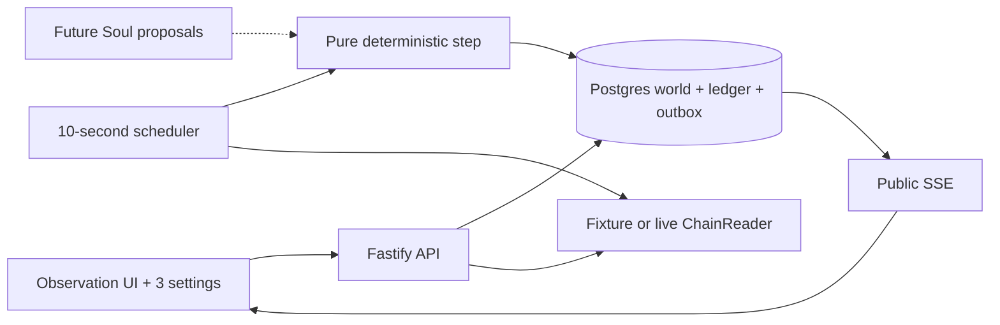

# Chog City: agent-run city builder

Date: 2026-10-19 (America/Los_Angeles). Status: build proposal incorporating the user's City direction; no City code has been implemented.

## 1. Brief and evidence

The user wants a teammate to start Chog City alongside the separate Awakening deployment work. Asked to choose between an agent world, a holder hub, and a city-building game, the user answered: **“1&3 mixed together, holders should be able to view and make a few settings.”**

Build an observation-first, agent-run city builder: NFT agents inhabit a shared world, gather resources, develop their plots, and interact. Holders watch their Chogs and adjust a small number of preferences; they do not need to steer every move or approve every game action.

The existing repository implements the Awakening contract proof, not a City application or Soul runtime. The original shared ChatGPT URL could not be retrieved. This document distinguishes the direction above from the proposed game rules below; those rules are implementation defaults, not quotations from an unavailable original spec.

### Proposed defaults to validate during the first demo

- Browser-based 2D world, one shared village initially.
- Each admitted NFT agent receives one offchain game plot; this is an in-game association with the NFT, not a separate land token or sale.
- Wood, stone and food are noncash integer game resources. Production and construction consumption form the first economy. Trading, token rewards and land monetization require a separate economy design.
- Deterministic, autonomous rules first; Soul/model integration later through a narrow decision interface. Do not label scripted behavior as model reasoning.
- A fixture village is playable without public RPC, a wallet, inference credentials or a successful deployment.

### Existing versus proposed

| Area | Current state | City work |
| --- | --- | --- |
| Awakening | Solidity adapter, upstream registry fixture, local transfer proof | Consume binding/current-controller interfaces |
| Public deployment | Testnet adapter receipt, deployed code and configuration independently verified | Export/validate the live manifest using `artifacts/monad-testnet-deployment-verification.json`; public awakening/transfer proof remains separate |
| Soul | No implemented runtime here | Future `DecisionProvider`; deterministic default now |
| City | No frontend, API, DB, simulation or art package | Build independent `city/` npm package |
| Economy | No prior City rules in the workspace | Proposed noncash production/build loop below |

## 2. First playable loop

1. Open a populated village and see residents working, inventories changing, and buildings developing.
2. Select a Chog to inspect its NFT/agent provenance, home plot, current activity, resource balances and public history.
3. As its holder, change only **Run/Pause**, **Focus**, and **Home Style**.
4. An active builder gathers missing resources, reserves materials for a house, completes it over two eligible simulation ticks, then works toward the next level.
5. A gatherer stocks resources; a social Chog visits the Plaza and greets nearby residents. Activity appears in the world and public feed.
6. Refresh, reconnect or restart the server: the same world and inventories remain.
7. Transfer the NFT: its public resident, plot, completed buildings, unspent resources and history persist. Old-owner control ends; unfinished work is cancelled and its reservations released. The new owner explicitly activates the Chog under a new policy.

### MVP scope

One village; 12 buildable plots; 8 fixture residents; 3 home appearances; home levels 0–2; wood/stone/food; deterministic autonomous simulation; public map/resident details/economy feed; three owner settings; fixture transfers; wallet/current-owner integration later.

Public landmarks: Plaza, Tavern and Workshop. Resource sites: Forest, Quarry and Farm. These are semantic destinations, not physics/collision arenas. Plot coordinates and paths come from a versioned world file. Maximum admitted residents equals buildable plot count; overflow returns `CITY_FULL`, never overlapping plots.

Defer free movement, 3D, DMs, voice/video, manual management of every action, player trading, currency/credits, tradable land, governance/Cult, Discord bots, onchain spending, arbitrary tools and private memory. Human free-text chat is optional after the builder loop; MVP social activity uses labelled templates.

## 3. Exact initial game rules

These values make the first slice implementable and testable. Keep them in one versioned `rules.ts`, not scattered UI constants.

| Rule | Prototype value |
| --- | --- |
| Logical tick interval | 10 seconds |
| Admission grant, once per city/NFT | 4 wood, 2 stone, 4 food |
| Inventory cap | 20 total units of each resource, including reserved units |
| Gather wood | Consume 1 available food, gain 3 wood; location Forest |
| Gather stone | Consume 1 available food, gain 2 stone; location Quarry |
| Gather food | Gain 3 food, no input cost; location Farm |
| Build level 1 | Reserve/consume 6 wood, 4 stone, 2 food |
| Build level 2 | Reserve/consume 12 wood, 8 stone, 4 food |
| Construction duration | 2 subsequent eligible ticks after construction starts |
| Focus values | `builder`, `gatherer`, `social` |
| Home styles | `moss`, `brick`, `timber`; cosmetic only, identical recipes |
| Social greeting cooldown | 6 logical ticks per resident |
| Offline catch-up | At most 3 due ticks; skip excess wall time explicitly |

All quantities are integers. `available = total - reserved`; require `0 <= reserved <= total <= 20`. Gathering clips output to remaining capacity and does not charge food for a zero-yield action. Resource sites are renewable in MVP; there is no hidden world depletion or market price.

### Deterministic priorities

- An inactive/unavailable resident takes no productive action. Temporary chain unavailability freezes construction progress and retains reservations; it is not a burn or transfer.
- An existing construction advances by one eligible tick. Completion consumes its reserved inputs exactly once and updates the completed building. Do not start another action in the completion tick.
- Builder: if home level is 2, use social/idle behavior. Otherwise gather food when available food is below 2; gather missing wood, then missing stone, then missing food for the next recipe; start construction only when all costs are available. No arbitrary random action selection.
- Gatherer: gather food when available food is below 2; otherwise choose the resource with the largest deficit from cap 20, tie order wood → stone → food; idle if all are full.
- Social/finished builder: move to Plaza if elsewhere; then greet one co-located resident when cooldown allows; choose the next target by stable sorted agent key with a rotating tick-based offset. Otherwise idle.
- Every resident gets at most one game action per tick; that action can produce several ledger/state effects. Gathering combines relocation to the named resource site with input consumption/output production in that tick. Construction start combines returning to the home plot with reserving its recipe. Social movement to Plaza is a separate action. Iterate in stable agent-key order; no additional pathfinding/travel ticks are inserted into the initial rules.

### Construction, pause and transfer

Starting a build increases reserved balances but does not debit total balances. Completion decreases both reserved and total balances by the recipe cost. Cancellation releases reserved balances without debiting total. Any effective policy change, pause, transfer or burn cancels unfinished construction exactly once. Completed buildings are never rolled back by those events.

Store `remainingTicks`, starting policy version, ownership epoch, costs and stable action ID. Progress decreases only when that resident is active and ownership is verified for the tick. Do not complete a frozen resident's build merely because unrelated global ticks passed.

An NFT transfer creates no new admission grant and no new plot. Burned residents become read-only ruins; completed public state remains, construction is cancelled, and their plot is not silently reassigned. Classify a burn from canonical collection evidence, not a generic failed owner call. Re-observing the same burn is idempotent. If that collection later remints the same token ID, advance its epoch and restore paused control over the existing state without another grant/plot. Plot reclamation is a later explicit rule.

## 4. Holder controls and presentation

The owner panel has exactly three primary controls:

1. **Run/Pause** — enables or stops autonomous game activity.
2. **Focus** — Builder, Gatherer or Social, with one-line explanations of the policies above.
3. **Home Style** — Moss, Brick or Timber. A style change affects the current completed home's appearance immediately and future builds; it has no resource advantage.

Save settings atomically using an expected policy version and idempotency key. Return the new authoritative policy/version. No-op saves do not advance the version or cancel work. A real change cancels unfinished work and releases reservations; say this next to Save when construction is in progress. No signature per tick and no transaction for settings.

The persistent agent policy continues while the holder is offline or signed out. **Logout ends the human session; Pause stops the Chog.** On transfer, default to paused with builder focus; retain the public completed appearance, but do not retain an old owner's private future preferences or credentials.

### Screen structure

- `/city`: world first, visible economy/activity, selected resident details, one compact owner settings panel.
- Desktop: dominant map, place/resident navigation at left, selected resident/settings at right, public feed along the lower edge or panel.
- Mobile: Map / Residents / Activity tabs; selected resident appears in a dismissible bottom sheet.
- A list/table alternative exposes every plot, resident and resource quantity to keyboard and assistive-technology users. Use real buttons, labelled controls, visible focus, 44px targets, status text alongside color and reduced motion.
- Label modes `Fixture Village`, `Testnet Village` or `Mainnet` accurately. Label scripted activity `Scripted` until a real Soul provider is enabled.
- Show resource **total**, **reserved** and **available**, building level/progress, focus, run state, and last verified ownership block. Never show uncommitted spending/build completion as success.

### Art and reference direction

This is a proposed visual direction, not an approved art lock. Use a functional SVG map and labelled avatar/house placeholders for the first demo. Final terrain, Chog sprites and buildings need an approved asset set; do not treat rough CSS boxes as finished world art.

Live Refero tools were unavailable. Research used its bundled craft/motion/anti-template references and official product-pattern sources:

| Decision | Reference / role | Adaptation |
| --- | --- | --- |
| Shared place dominates the interface | [Gather](https://www.gather.town/) as spatial-presence reference | World, residents and presence; not a video meeting product |
| Places have predictable navigation | [Discord categories](https://support.discord.com/hc/en-us/articles/115001580171-Channel-Categories-101) | Fixed named places; not a complex permissions editor |
| Semantic controls and stable images | Refero bundled craft guidance | Accessible list alternative, focus return, reserved avatar dimensions |
| Motion explains state/location | Refero bundled motion guidance | 120–240ms UI transitions, interruptible movement, reduced-motion text |
| Prototype remains honest | User's watch/settings brief; Refero art guidance | Game screen first; no generic marketing hero or unrelated KPI cards |

Temporary prototype tokens: surface `#EEF2F6`, ink `#13212E`, action `#1966C2`, caution `#A15500`, error `#B42318`; system sans UI, monospace IDs. These are functional roles, not asserted Chog brand colors. Finalize one approved desktop/mobile screen in `city/docs/art-direction.md` before production art/polish.

## 5. Architecture and package boundary

Leave the root Solidity code, root lockfile and root `.env` to Claude. Build inside independent `city/`, with its own package/lockfile, config and tests. No new Solidity contract is required.

Proposed stack: React + Vite + TypeScript; Fastify + TypeScript on Node 24; PostgreSQL + `pg` and SQL migrations; ethers 6.17.0 for chain reads; Zod at boundaries; Vitest/Testing Library and Playwright. Pin compatible versions in the City lockfile during implementation; these packages have not been installed by this planning task. See [Vite](https://vite.dev/guide/), [React](https://react.dev/learn/creating-a-react-app) and [Fastify](https://fastify.dev/docs/latest/Guides/Getting-Started/) documentation.



Use one API and one simulation process. No broker, Redis, distributed action workers or wallet executor in MVP. Wall-clock scheduling decides which logical tick is due; game transitions use persisted ticks/rules, not `Date.now()` or `Math.random()`.

### Modes

- `fixture`: local dev/test only, loopback API, deterministic A/B actors and ownership ledger; no root `.env`, RPC, wallet or model key. Production startup rejects fixture mode and never registers fixture session/transfer hooks.
- `live`: EOA wallet login, an allowlisted verified manifest, ownership projection, same simulation rules. No fixture fallback when RPC fails.
- First UI milestone can use an in-memory fixture client. Persistent fixture demo uses the same Postgres repository as live.

## 6. Shared domain and identity

All uint256 IDs are canonical decimal strings, including `"0"`; validate the uint256 maximum, not just string length. Addresses normalize to lowercase in keys and checksum only for display. SQL bigints/tick/revision/epoch values cross JSON as decimal strings.

```ts
type AgentKey = string; // constructed only by makeAgentKey()
type Resource = 'wood' | 'stone' | 'food';
interface AgentIdentity {
  chainId: 31337 | 10143 | 143;
  registry: string; adapter: string; collection: string;
  tokenId: string; agentId: string;
}
// AgentKey = chainId:registry:adapter:collection:tokenId:agentId
interface AgentPolicy {
  active: boolean;
  focus: 'builder' | 'gatherer' | 'social';
  homeStyle: 'moss' | 'brick' | 'timber';
  version: string; ownershipEpoch: string;
}
type ControlObservation =
  | { kind: 'controlled'; controller: string; ownershipEpoch: string;
      blockNumber: string; blockHash: string; observedAtMs: number;
      projectionGeneration: string }
  | { kind: 'burned' | 'not_awakened'; ownershipEpoch: string;
      blockNumber: string; blockHash: string; observedAtMs: number;
      projectionGeneration: string }
  | { kind: 'unavailable'; reason: 'rpc' | 'indexer_lag' | 'reorg' };
interface ChainReader {
  resolveAgent(identity: AgentIdentity): Promise<ControlObservation>;
}
interface CanonicalControlState {
  kind: 'controlled' | 'burned' | 'not_awakened';
  controller: string | null;
  ownershipEpoch: string; projectionGeneration: string;
  blockNumber: string; blockHash: string; observedAtMs: number;
}
interface TickInput {
  tick: string; seed: string; rulesetVersion: string;
  world: WorldState; observations: Record<AgentKey, ControlObservation>;
}
interface TickResult {
  world: WorldState; effects: GameEffect[]; ledger: LedgerEntry[];
  publicChanges: PublicAgentChange[];
}
// step(input: TickInput): TickResult is pure and deterministic.
```

`WorldState`, `GameEffect`, `LedgerEntry` and public DTO schemas are defined once in shared contracts during Task 1. Each agent stores `control: CanonicalControlState` plus `controlAvailability: 'verified'|'unavailable'`. An unavailable observation changes availability, not the last canonical controller/epoch; normal new block observations update evidence without repeatedly emitting a control-change event. Effects are allowlisted production/reserve/consume/release/build/visit/greet results; no arbitrary RPC/HTTP/tool call is an effect.

Live identity resolution verifies a server-owned manifest, adapter binding consistency and current controller. Registry `ownerOf(agentId)` returns adapter custody, not the holder's identity. Client-supplied contracts/RPCs cannot choose the trusted world. Also enforce one admitted resident per city/chain/collection/token to prevent duplicate game grants across adapters. Canonical observations carry the projection generation for controlled/burned/missing results; repeated reconciliation of an unchanged epoch/generation/status emits no control change. An unavailable result is transient and cannot invent a new epoch or cancel reserved work.

## 7. Auth, control and ownership changes

Use [SIWE / ERC-4361](https://eips.ethereum.org/EIPS/eip-4361) for EOA login: validate exact configured domain/URI, allowed chain, nonce, issue/expiry times and signature; atomically consume each challenge once. A wallet session authenticates an address, not continuing NFT control.

Defaults: 5-minute challenge; 12-hour session; 32 random bytes for challenge/session material; encode the SIWE nonce as 64 hexadecimal characters and store the session-token hash. HttpOnly, SameSite=Lax, host-only cookie, Secure in production; exact Origin and per-session CSRF checks on settings. No session token in URLs/localStorage. V1 explicitly rejects unsupported contract-wallet login; ERC-1271 compatibility is deferred.

Every settings write and owner-only read checks a fresh coherent control observation, controller address, ownership epoch and expected policy version. RPC unavailable gives 503 `OWNERSHIP_UNAVAILABLE`, not fabricated missing/burned ownership. Public viewing remains available with a stale-data label.

The simulation runs under the durable agent policy, not the browser session. It checks current control at each eligible tick. Transfers advance an authorization epoch for **every** Transfer event, including A→B→A; latest owner-address comparison alone is insufficient. At admission store activation block/hash and epoch 1; index subsequent collection Transfer logs with durable block/hash checkpoints. Protected reads/settings/ticks require the projection caught up to their observation block within an 8-second dependency budget.

Transfer handling, under the same City transaction lock: advance epoch; pause; reset focus to builder; retain completed appearance; cancel construction/release reservations; retain plot, total unspent resources, completed buildings and public history. No admission grant repeats. Buyer activation requires fresh ownership and a new policy version. Private future memory/credentials are never transferred implicitly.

Reorg: invalidate affected control observations, advance an authorization generation and pause affected residents; rebuild from the last common checkpoint without reviving old policies. Retain at least 64 block hashes; deeper mismatch stops affected protected processing for resync.

Offchain checks cannot atomically order an NFT transfer racing between the last RPC observation and SQL commit. Record observation block/hash, fence on observed epoch and apply transfer cancellation when detected. Do not promise instantaneous cryptographic revocation or allow asset-moving tools across this gap.

## 8. Persistence and simulation transactions

| Table | Responsibility / required constraints |
| --- | --- |
| `city_runtime` | Last committed tick, next due time, public revision, seed, ruleset version; one serialization row per city |
| `agents`, `agent_control`, `agent_policies` | Full identity, activation block, observed controller/epoch, policy/version, current location |
| `plots`, `buildings`, `constructions` | Unique city coordinate, one plot/resident, level 0–2, one ongoing build/resident, stable action ID/costs/remaining ticks |
| `inventories`, `resource_ledger` | Integer total/reserved per resource, nonnegative checks, unique ledger cause/line key |
| `simulation_ticks` | Unique `(city_id,tick_no)`, input/result hashes, ruleset and observation summary |
| `city_events` | Commit-ordered public revision, strict type/payload, created time |
| `auth_challenges`, `sessions` | Atomic nonce consumption, hashed cookie, expiry/revocation |
| `idempotency_records` | Session/agent/operation/key, normalized payload hash, saved settings response |
| `ownership_checkpoints` | Chain/collection block/hash cursor and canonical tail |

Admission assigns the first free plot in stable plot-ID order under the City lock and grants resources exactly once with a unique city/NFT admission cause. No `tokenId % plotCount` allocation. When full, do not debit or create partial residents.

### Tick commit protocol

1. Capture the due tick number and due timestamp plus monitored identities. Fetch coherent ownership observations outside database locks; classify unavailable agents as frozen.
2. Use one checked-out pg client and begin a transaction. Lock `city_runtime`; if the captured expected tick is already committed, return its existing result. Otherwise require it to be exactly lastTick+1, require the captured due timestamp to match, and require that timestamp to be due. Stale metadata returns refresh/not-due; never turn a duplicate request for tick n into a new award for n+1.
3. Load the current world/policies; reconcile observations against the current projection generation. Ignore older generations or observations older than 8 seconds and freeze affected agents; never overwrite a newer transfer projection. Read production scheduling time from the database clock; inject it in deterministic tests.
4. Run pure `step()` using the current locked state and the next logical tick. Apply resource ledger, reservations, buildings, locations, tick record and public event atomically.
5. Advance last tick/next due time/revision and commit. Publish only by reading the committed outbox.

Settings/admission/transfer handlers use the same city-row lock before agent rows. No network or inference call while holding a SQL lock. See [node-postgres transaction guidance](https://node-postgres.com/features/transactions).

The public revision comes from the locked `city_runtime` row, not a standalone SQL sequence whose allocation order can differ from commit order. A lost commit response followed by retry must return the existing tick, not apply resources again. Sum of ledger deltas reconciles balances; reservations are not charged twice.

The scheduler processes at most 3 overdue ticks, persists the skipped downtime interval, then schedules the next tick for now+10 seconds. Never simulate unlimited offline rewards or future ticks. A closed browser does not pause a running server; server downtime is a disclosed world pause.

## 9. Realtime and HTTP interfaces

Public snapshots include village clock, places, plots/buildings, residents, inventories/reservations, policies, current activities and recent public feed. No wallet session data, private future prompts, signatures or credentials.

Use one public SSE connection/tab. [SSE](https://developer.mozilla.org/en-US/docs/Web/API/Server-sent_events/Using_server-sent_events) provides IDs/reconnect; the application supplies durable replay. Snapshot plus revision comes from one repeatable-read view; subscribe after that revision. Last-Event-ID takes precedence on reconnect. Clients ignore duplicates. Retain 10,000 revisions; an older cursor produces `reset` and a new snapshot. Snapshot failure never advances the cursor. Heartbeat every 15 seconds; disconnect a slow client after a 100-event buffer.

Public event schemas: `city_tick`, `policy_changed`, `control_changed`, `resident_admitted`, `simulation_gap`. A city tick contains changed public resident/plot/inventory DTOs plus compact activity lines; no internal SQL objects. The authoritative tick drives building progress; animations never mint resources or complete buildings.

| Method / path | Contract | Access |
| --- | --- | --- |
| `GET /api/health` | Mode/readiness, no configuration secrets | Public |
| `GET /api/city/snapshot` | `{revision,tick,nextDueAt,world,recentEvents}` | Public |
| `GET /api/city/events?after=revision` | Public SSE | Public |
| `GET /api/agents/:agentKey` | Public resident, inventory, plot/building, activity, provenance | Public |
| `POST /api/auth/challenge` | `{address,chainId}` → server-issued SIWE message | Rate limited |
| `POST /api/auth/verify` | `{message,signature}` → cookie/CSRF token | Single-use challenge |
| `POST /api/auth/logout` | Revoke human session; does not pause active Chogs | Session |
| `GET /api/me/agents` | Admitted controlled residents and control/settings availability | Session + current reads |
| `PATCH /api/agents/:agentKey/policy` | `{expectedVersion,expectedEpoch,active,focus,homeStyle}` + Idempotency-Key → policy | Current holder |
| `POST /api/admissions` | Allowlisted `{tokenId}`; resolve identity, plot, bootstrap resources once | Current holder |
| `POST /api/dev/session` / `POST /api/dev/transfer` | Deterministic fixture actor/transfer | Local fixture dev/test only |

Settings idempotency scope: `(session_id,agent_key,operation,key)`. Same key/body returns the same response; changed body returns 409 `IDEMPOTENCY_CONFLICT`. A stale settings form returns 409 `POLICY_CHANGED`/`CONTROL_CHANGED`, not silent last-writer overwrite. Error envelope: `{error:{code,message,requestId}}`.

Other codes: 400 `INVALID_INPUT`; 401 `LOGIN_REQUIRED`; 403 `NOT_CONTROLLER`; 409 `CITY_FULL`; 429 `RATE_LIMITED`; 503 `OWNERSHIP_UNAVAILABLE`. No manual spending/resource-grant API exists.

## 10. Limits, integration and acceptance

- Settings: 10 updates/minute/session/agent, 16KB request limit, strict enum schemas. Login challenge 20/IP/15min; verify 10/IP/15min.
- Load target: 12 productive residents and 20 simultaneous pilot viewers. Public API p95 target under 250ms on the agreed test setup; fixture policy writes under 500ms. Live dependencies have an 8-second budget. Measure these; they are not current performance claims.
- Use approved local/manifest-owned assets; do not fetch arbitrary metadata URLs in MVP. Escape every displayed string; later Soul output remains untrusted data.
- Log request/tick IDs, safe RPC host/method, ownership block/hash, policy/epoch conflicts, ledger reconciliation failures and skipped downtime. Redact cookies/signatures, keys and RPC URL paths/query strings.
- Claude owns root recovery; City teammate owns `city/`. A live manifest requires verified chain/registry/adapter/collection addresses, receipts/blocks, ABI/artifact hashes and activation block/hash. Prepared/pending records do not establish a usable deployment.
- TestChog remains labelled test-only. No canonical ERC-8217 claim or mainnet launch is implied.

**Pilot acceptance:** two viewers see the same resource/build progress; holder changes one focus and observes different autonomous behavior; pause cancels/resolves reservations correctly; restart/reconnect loses no state; duplicate ticks never duplicate rewards; A→B and A→B→A cannot revive seller control; buyer keeps public developed state but must activate a new policy; RPC failure freezes affected production honestly. The teammate's first fixture milestone must run without waiting for Claude's deployment repair.
